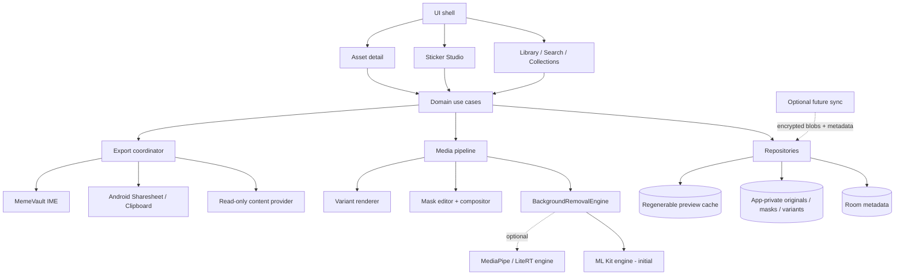

# MemeVault — Kế hoạch thiết kế hệ thống hoàn chỉnh

Ngày lập: 2026-08-30  
Phạm vi gần: Android, local-first, tạo và tái sử dụng meme/sticker/GIF  
Phạm vi xa: đồng bộ đa thiết bị và iOS, chỉ thực hiện sau khi luồng local đạt product-market fit

Trạng thái triển khai: quick static-image slice đã được đưa vào app (picker → lưu original → crop
nhanh trước segmentation → ML Kit → threshold/viền preview → PNG sticker → share/copy). Room V3
storage-first recipe/mask/tag foundation, quick picker và Sticker keyboard flow đã triển khai;
brush editor và quality verification trên thiết bị thật vẫn là phase tiếp theo.

## 1. Tóm tắt quyết định

MemeVault nên phát triển thành một **media vault + Sticker Studio**, không phải một bàn phím chữ
thay thế Gboard/Laban Key. App giữ bản gốc bất biến, tạo các biến thể có thể tái sinh, rồi đưa
media sang ứng dụng khác bằng API công khai của Android.

Tính năng mới quan trọng nhất là **Tạo sticker từ ảnh**:

1. Chọn hoặc nhập ảnh.
2. Tách chủ thể trên thiết bị.
3. Cho xem trước và sửa vùng giữ/xóa.
4. Tự crop, thêm padding/viền nếu cần.
5. Lưu PNG nền trong suốt như một variant của ảnh gốc.
6. Chèn qua bàn phím khi app đích hỗ trợ MIME, nếu không thì Copy hoặc Sharesheet.

Quyết định cho engine tách nền:

- Bản đầu dùng `ML Kit Subject Segmentation` sau một quality spike vì nó hỗ trợ người, vật nuôi
  và vật thể nổi bật, phù hợp mục tiêu tạo sticker từ ảnh tĩnh.
- Domain chỉ phụ thuộc `BackgroundRemovalEngine`, không phụ thuộc trực tiếp ML Kit. API ML Kit
  hiện là beta, model tải động qua Google Play services và có thể thay đổi.
- Chỉ bổ sung engine MediaPipe/LiteRT đóng gói khi quality gate cho thấy nhu cầu thực tế: thiết bị
  thiếu Google Play services, tải model thất bại nhiều hoặc chất lượng/độ ổn định không đạt.
- Không upload ảnh để tách nền trong phiên bản đầu. Cloud removal chỉ có thể là lựa chọn opt-in về
  sau, kèm chính sách lưu giữ và xóa dữ liệu rõ ràng.

## 2. Mục tiêu và ranh giới sản phẩm

### Mục tiêu

- Lưu ảnh, meme, sticker, GIF và video cục bộ, chống trùng bằng hash.
- Tìm nhanh bằng tên, tag, collection, favorite và lịch sử dùng gần đây.
- Tạo sticker nền trong suốt từ ảnh tĩnh trong một luồng ngắn, dễ hiểu.
- Bảo toàn bản gốc; mọi thao tác chỉnh sửa tạo recipe/variant có thể tái sinh.
- Chia sẻ bằng `content://`, MIME chính xác và quyền đọc tạm thời.
- Bàn phím media có Recent/Favorites/Collections, tìm kiếm và nút đổi về IME khác.
- Hoạt động offline sau khi model tách nền đã sẵn sàng.
- Không thu thập nội dung chat, người nhận hoặc ảnh của người dùng vào telemetry.

### Không làm trong Android V1

- Không chèn sticker vào catalogue riêng của Messenger, Zalo hoặc TikTok.
- Không tự đăng bài hoặc tự thao tác UI app khác.
- Không tách nền từng frame cho GIF/video; đây là bài toán riêng về temporal consistency.
- Không xây backend, login và cloud sync trước khi luồng local được kiểm chứng.
- Không biến MemeVault thành bàn phím nhập chữ đầy đủ.
- Không xóa hay ghi đè file gốc khi tạo sticker.

## 3. Hiện trạng và khoảng cách cần lấp

Hiện app đã có Android native Kotlin, Room, app-private media, import từ picker/share receiver,
grid/search/favorite/delete, Sharesheet/clipboard, GIF-to-MP4 best-effort và IME media.

Các khoảng cách kiến trúc chính:

- UI, persistence, media processing và platform adapter đang cùng một app module.
- Chưa có processing job bền vững, cọ giữ/xóa hoặc trạng thái model chi tiết.
- `asset_variants` chưa lưu kích thước, hash, engine/version, trạng thái và recipe nguồn.
- Asset Detail/Sticker Studio đã có quick create, recipe/mask restore và tag editor; undo/redo
  và chỉnh mask thủ công vẫn chưa có.
- IME cần hoàn thiện contract switch chính thức: khai báo
  `supportsSwitchingToNextInputMethod`, kiểm tra `shouldOfferSwitchingToNextInputMethod()` và giữ
  system picker làm fallback.
- Kiểm chứng thật trên Messenger/Zalo/TikTok và nhiều phiên bản Android còn thiếu.

## 4. Kiến trúc mục tiêu

Không tách nhiều Gradle module ngay. Giai đoạn đầu tổ chức theo package và interface rõ ràng; chỉ
tách module khi build time, test isolation hoặc ownership thực sự cần.



### Package đề xuất

| Package | Trách nhiệm |
|---|---|
| `ui.library` | Grid, search, filter, collection và empty/error states |
| `ui.studio` | Crop, preview mask, refine, outline, save/share |
| `domain.asset` | Asset, variant, collection, recipe và use case |
| `data.db` | Room entity, DAO, migration |
| `data.files` | Atomic file store, staging, cleanup |
| `media.importer` | MIME sniffing, EXIF orientation, hash, metadata |
| `media.segmentation` | Engine interface, model availability, result mask |
| `media.mask` | Threshold, feather, brush delta, crop alpha bounds |
| `media.render` | Transparent PNG/WebP và destination profiles |
| `platform.share` | Provider, Sharesheet, clipboard, grants |
| `platform.ime` | Recent/Favorites, commitContent, switch IME |
| `jobs` | Persistent import/conversion/cleanup; sync về sau |

## 5. Thiết kế Sticker Studio

### Luồng người dùng nhanh

1. Từ Library chọn **Tạo sticker**.
2. Chọn ảnh hiện có hoặc nhập ảnh mới.
3. App kiểm tra model:
   - `READY`: chạy tách nền ngay;
   - `DOWNLOADING`: hiện progress và cho hủy;
   - `UNAVAILABLE`: giải thích nguyên nhân, cho retry hoặc lưu ảnh thường.
4. Hiện before/after trên nền caro; nếu có nhiều chủ thể, cho chạm để giữ từng chủ thể.
5. Bản nhanh có thanh **Giữ nhiều hơn ↔ Xóa nhiều hơn** và điều chỉnh feather.
6. Bản V1 bổ sung cọ **Giữ/Xóa**, zoom/pan, undo/redo, viền và shadow.
7. Bấm **Lưu sticker** để tạo variant PNG nền trong suốt; sau đó có Chèn, Copy, Chia sẻ.

### Pipeline xử lý

```text
URI đầu vào
  -> persist original + SHA-256 dedupe
  -> đọc orientation/dimensions và decode có giới hạn
  -> chuẩn hóa bitmap làm việc (sRGB, đúng rotation, cạnh dài tối đa cấu hình)
  -> BackgroundRemovalEngine.segment()
  -> confidence mask
  -> threshold + morphology nhẹ + feather
  -> áp brush delta của người dùng
  -> tính alpha bounds + crop + padding
  -> tùy chọn outline màu + độ dày theo tỉ lệ cạnh dài
  -> render transparent master PNG
  -> tạo variant theo profile
  -> ghi Room transaction
  -> atomic rename từ staging
```

### Quy tắc chất lượng và tài nguyên

- Giữ nguyên original bytes và metadata gốc trong vùng private.
- Derived sticker phải bỏ EXIF/GPS và metadata không cần thiết.
- Decode cho editor theo sample size; đề xuất cạnh dài làm việc tối đa 2048 px.
- Lưu master transparent tối đa 2048 px, đồng thời tạo profile 512 px cho chia sẻ nhẹ.
- Mask dùng confidence `0..1`; threshold/feather là tham số của recipe, không bake cứng vào domain.
- Luôn dùng staging + atomic move; cancel/error phải xóa file dở nhưng không xóa original.
- Cache theo `sourceHash + recipeHash + engineId + engineVersion` để tránh chạy lại vô ích.
- Ảnh quá lớn, hỏng hoặc MIME không khớp phải trả error code có thể giải thích cho người dùng.

### Interface tách nền

```kotlin
interface BackgroundRemovalEngine {
    suspend fun availability(): EngineAvailability
    suspend fun prepare(): EngineAvailability
    suspend fun segment(request: SegmentationRequest): SegmentationResult
}

data class SegmentationResult(
    val foregroundMask: ConfidenceMask,
    val subjects: List<SubjectMask>,
    val engineId: String,
    val engineVersion: String,
    val elapsedMs: Long,
)
```

Domain không nhận trực tiếp `Bitmap` của SDK. Adapter chuyển kết quả SDK thành mask trung lập để
renderer, test và engine fallback không phụ thuộc vendor.

## 6. Lựa chọn engine tách nền

| Tiêu chí | ML Kit Subject Segmentation | MediaPipe/LiteRT bundled |
|---|---|---|
| Phù hợp ảnh sticker đa dạng | Tốt cho người, thú cưng, vật thể nổi bật | Phụ thuộc model; model mẫu chủ yếu người hoặc nhóm category cố định |
| Phân tách nhiều chủ thể | Có | Phụ thuộc model/output |
| Cài đặt | SDK nhỏ, model tải qua Play services | Phải đóng gói/quản lý model |
| Offline lần đầu | Không bảo đảm nếu model chưa tải | Có nếu model nằm trong APK/asset pack |
| Thiết bị không có Play services | Rủi ro không dùng được | Có thể hoạt động |
| Ổn định API | Hiện là beta | API/runtime chủ động hơn, nhưng model và acceleration do app quản lý |
| Chi phí triển khai ban đầu | Thấp hơn | Cao hơn |

Quyết định triển khai:

1. Làm spike ML Kit trên bộ fixture đại diện.
2. Chỉ ship engine này nếu đạt quality/performance gate.
3. Giữ UI đầy đủ state tải model, retry và unavailable.
4. Không ship hai engine cùng lúc trong bản đầu.
5. Kích hoạt nhánh MediaPipe/LiteRT nếu tỷ lệ unavailable hoặc chất lượng thực tế vượt ngưỡng đã
   định trong release gate.

## 7. Mô hình dữ liệu Room V2

### Bảng hiện hữu cần giữ

- `assets`: bản gốc và metadata lâu dài.
- `asset_variants`: biến thể có thể tái sinh.
- `tags`, `asset_tags`: tổ chức và tìm kiếm.

### Bảng/cột bổ sung

| Thành phần | Trường chính | Mục đích |
|---|---|---|
| `asset_variants` V2 | `id`, `asset_id`, `profile`, `path`, `mime_type`, `hash`, `width`, `height`, `status`, `recipe_id`, `engine_id`, `engine_version` | Truy nguồn và kiểm tra variant |
| `sticker_recipes` | `id`, `source_asset_id`, `threshold`, `feather_px`, `crop_rect`, `padding_ratio`, `outline`, `shadow`, `revision`, timestamps | Chỉnh lại hoặc render lại sticker |
| `sticker_masks` | `recipe_id`, `base_mask_path`, `brush_delta_path`, `width`, `height`, `hash` | Lưu mask trung lập, không phụ thuộc SDK |
| `processing_jobs` | `id`, `asset_id`, `kind`, `status`, `progress`, `error_code`, `attempts`, timestamps | Khôi phục sau process death, retry có kiểm soát |
| `collections` | `id`, `name`, `sort_order`, timestamps | Nhóm sticker/meme |
| `collection_assets` | `collection_id`, `asset_id`, `sort_order` | Quan hệ nhiều-nhiều |

Migration phải là Room migration tường minh từ schema 1 sang 2; không dùng destructive migration.
Xóa asset phải cascade metadata và xóa original/mask/variant theo file transaction có thể retry.

### File layout

```text
files/media/
  staging/
  originals/<asset-id>/original.<ext>
  masks/<asset-id>/<recipe-id>/base-mask.webp
  masks/<asset-id>/<recipe-id>/brush-delta.webp
  variants/<asset-id>/sticker-master.png
  variants/<asset-id>/sticker-512.png
  variants/<asset-id>/tiktok.mp4
cache/
  previews/<asset-id>/<variant-key>.webp
```

## 8. Xử lý nền, concurrency và khôi phục

- Segmentation tương tác chạy trên background dispatcher có cancellation; không block main thread.
- Mỗi asset chỉ có một job cùng `kind/profile` tại một thời điểm.
- `WorkManager` chỉ dùng cho công việc phải sống qua process death: import lớn, generate variant,
  cleanup orphan và sync về sau. Không đẩy từng thao tác brush vào WorkManager.
- Job có trạng thái `QUEUED`, `PREPARING_MODEL`, `RUNNING`, `SUCCEEDED`, `FAILED`, `CANCELED`.
- Retry chỉ cho lỗi transient như model download/network/runtime tạm thời; ảnh hỏng hoặc unsupported
  không retry tự động.
- Khi mở lại app, job dở được reconcile với staging và metadata thay vì tạo bản trùng.

## 9. Export và bàn phím

### Chọn variant

| Đích | Variant ưu tiên | Fallback |
|---|---|---|
| Editor quảng cáo `image/png` | Sticker PNG qua `commitContent()` | Clipboard URI hoặc Sharesheet |
| Messenger/Zalo baseline | PNG/JPEG/GIF phù hợp qua Sharesheet | Copy rồi hướng dẫn dán |
| TikTok/Zalo ảnh sticker | Người dùng chọn PNG trong suốt 320px thử nghiệm hoặc opaque PNG 512px có đệm qua Sharesheet | Đổi profile, PNG gốc hoặc Copy nếu app đích vẫn xử lý sai |
| TikTok animation | MP4/H.264 variant | Chia sẻ GIF gốc qua system nếu app đích nhận |

### IME

- Header cố định: đổi bàn phím, tìm kiếm, mở MemeVault.
- Tabs: Recent, Favorites, Collections.
- Chỉ gọi `commitContent()` khi `EditorInfo.contentMimeTypes` hỗ trợ MIME.
- Dùng read-only provider và read grant cho đúng URI.
- Khai báo `supportsSwitchingToNextInputMethod="true"`, chỉ hiện switch key khi platform cho biết
  nên hiện; system picker luôn là fallback.
- Không lưu text đang nhập, tên cuộc chat, contact hoặc package history chi tiết.

## 10. Màn hình và trạng thái UX

| Màn hình | Nội dung chính | Trạng thái bắt buộc |
|---|---|---|
| Library | Grid, search, filter, collection, create sticker | loading, empty, data, error |
| Import review | Preview, tên, tag, loại media | unsupported, duplicate, cancel, success |
| Asset detail | Original/variants, favorite, edit, delete, share | missing file, regenerate variant |
| Sticker Studio | before/after, subject picker, refine, outline, save | model download, running, no subject, retry, canceled |
| Processing queue | Job và retry/cancel | queued, running, failed, completed |
| Keyboard setup | Enable/select IME và hướng dẫn đổi lại | permission/settings return |
| Settings | Storage, clear cache, model status, privacy | offline, low storage |

## 11. Bảo mật và riêng tư

- Photo Picker/ACTION_OPEN_DOCUMENT; không xin quyền đọc toàn bộ thư viện nếu không cần.
- Kiểm MIME bằng decoder/signature, giới hạn kích thước và thời lượng trước xử lý.
- Original, mask và variant nằm trong app-private storage.
- Derived sticker loại bỏ EXIF/GPS; original vẫn được bảo toàn riêng tư.
- Chỉ cấp quyền đọc tạm thời cho URI được chia sẻ; provider không exported.
- Không ghi bitmap, mask, URI private, chat text, người nhận hoặc token vào log.
- Analytics nếu có phải opt-in, chỉ ghi event/error code và bucket thời gian/kích thước.
- Model và dependency phải có license inventory/SBOM trước release.
- Cloud sync tương lai phải mã hóa blob phía client; thiết kế recovery key là release gate riêng.

## 12. Hiệu năng và SLO đề xuất

Các con số dưới đây là product target, phải đo trên thiết bị tầm trung đã chọn:

- Mở Library có dữ liệu cache: P95 dưới 500 ms.
- Hiện IME shell: P95 dưới 200 ms; asset có thể tải sau.
- Tách nền sau khi model sẵn sàng: P50 dưới 1.5 giây, P95 dưới 3 giây cho ảnh làm việc 2048 px.
- Không OOM với input hợp lệ 50 MB; peak memory mục tiêu dưới 256 MB trên device test.
- Save sticker + ghi DB/file: P95 dưới 1 giây sau khi mask đã có.
- Cancel không để lại Room row hoàn chỉnh hoặc file staging quá một chu kỳ cleanup.
- Output PNG phải giữ alpha và không chứa GPS/EXIF.

## 13. Chiến lược kiểm thử

### Unit

- Hash/dedupe, MIME routing, variant selection.
- Threshold, feather, crop alpha bounds, padding và compositing.
- Recipe hash/idempotency, state machine của processing job.
- Error mapping: model missing, no subject, decode failure, low storage.

### Integration

- Room migration 1→2 và cascade delete.
- Atomic staging/commit/recovery sau process death.
- Provider MIME/query/openFile và read grants.
- Model availability/download/retry adapter bằng fake engine.

### Golden/quality dataset

Dùng ảnh synthetic hoặc có license, gồm:

- người với tóc rối, kính, quần áo gần màu nền;
- chó/mèo và vật thể đơn lẻ;
- nhiều chủ thể chạm nhau;
- nền trong, nền phức tạp, thiếu sáng;
- ảnh xoay EXIF, HEIC/WEBP/JPEG/PNG;
- ảnh không có chủ thể và ảnh hỏng.

Chấm theo bộ tiêu chí: mất chủ thể, dính nền, halo cạnh, thời gian, peak memory và khả năng sửa tay.

### Device/host matrix

- Android API 26, 30, 33 và 36; ít nhất một máy low-RAM và một máy không/khó tải Play services.
- First-use online, first-use offline, model đã tải, download bị hủy.
- Messenger, Zalo, TikTok theo version cụ thể với PNG alpha, JPEG, GIF và MP4.
- IME switch, commitContent supported/unsupported, clipboard fallback và quay lại từ Sharesheet.

## 14. Roadmap triển khai

Ước lượng cho một Android developer tập trung; chưa gồm thời gian review store và test host app kéo dài.

### Phase 0 — Ổn định nền tảng, 3–5 ngày

- Chia package theo boundary nhưng giữ một Gradle module.
- Viết Room migration design và fixture schema 1.
- Chuẩn hóa error/result/progress model.
- Hoàn thiện IME switching contract theo tài liệu Android.
- Thêm instrumented test cho provider và IME seam.

Exit gate: build/test/lint xanh; migration test giữ nguyên thư viện hiện có; đổi bàn phím kiểm chứng
trên ít nhất một máy thật.

### Phase 1 — Background-removal spike, 4–6 ngày

- Tạo `BackgroundRemovalEngine` và fake engine.
- Adapter ML Kit, model readiness/download UI.
- Bộ 30–50 fixture và benchmark runner.
- So sánh quality, latency, memory, offline/unavailable.

Exit gate: đạt ngưỡng chất lượng đã thống nhất trên người, pet và object; nếu không đạt thì dừng để
đánh giá model MediaPipe/LiteRT trước khi xây editor.

### Phase 2 — Sticker Studio nhanh, 7–10 ngày

- Pick/import → auto remove → preview → crop/padding → save PNG.
- Room V2, mask/recipe/variant file store.
- Threshold/feather, chọn nhiều chủ thể, loading/error/cancel/retry.
- Share/Copy ngay sau save.

Exit gate: tạo sticker không phá original, khôi phục được sau process death, alpha/metadata test đạt.

### Phase 3 — Refine editor, 7–10 ngày

- Brush Keep/Erase, zoom/pan, undo/redo.
- Viền trắng/màu, shadow, padding presets.
- Recipe versioning và re-render không chạy lại segmentation nếu không cần.

Exit gate: sửa được các fixture tóc/halo/dính nền ở mức chấp nhận; thao tác không block UI.

### Phase 4 — Library và IME hoàn chỉnh, 5–7 ngày

- Collections, tags editor, recent/favorite ranking.
- IME tabs/search/switch/open app.
- Export profile resolver và compatibility matrix.

Exit gate: PNG có thể chèn ở editor hỗ trợ; mọi editor khác có next action rõ ràng.

### Phase 5 — Hardening/release candidate, 5–7 ngày

- Device matrix, low storage, process death, corrupted input, performance benchmark.
- Privacy review, EXIF stripping, dependency/license inventory.
- Backup/restore policy, release notes, signed build và manual acceptance.

Exit gate: không còn P0/P1, test host-app có version/evidence, các gap được ghi rõ thay vì quảng cáo
support chung chung.

### Phase 6 — Tương lai, không nằm trong Android V1

- Sync mã hóa đa thiết bị, conflict/tombstone và quota.
- Shared/private collections nếu có nhu cầu thật.
- iOS app + Share Extension + keyboard extension theo giới hạn iOS.
- GIF/video matting với temporal consistency.
- Cloud removal opt-in cho chế độ chất lượng cao.

## 15. Backlog ưu tiên

| ID | Priority | Hạng mục | Phụ thuộc |
|---|---|---|---|
| `MV-ARCH-001` | P0 | Package boundary + result/state contracts | Không |
| `MV-IME-002` | P0 | Contract chuyển IME + device test | Không |
| `MV-DB-002` | P0 | Room V2 migration + variant/recipe/job schema | ARCH |
| `MV-ML-001` | P0 | Engine abstraction + fake engine | ARCH |
| `MV-ML-002` | P0 | ML Kit spike + model readiness | ML-001 |
| `MV-QA-001` | P0 | Fixture set + quality/performance benchmark | ML-001 |
| `MV-STUDIO-001` | P1 | Quick Sticker Studio UI/state | DB, ML-002 |
| `MV-MASK-001` | P1 | Threshold/feather/crop/compositor | ML-001 |
| `MV-RENDER-001` | P1 | Master/512 PNG variants + EXIF stripping | DB, MASK |
| `MV-STUDIO-002` | P1 | Brush Keep/Erase + undo/redo | STUDIO-001 |
| `MV-LIB-002` | P1 | Collections + tag editing | DB |
| `MV-IME-003` | P1 | Recent/Favorites/Collections/search | LIB, RENDER |
| `MV-EXPORT-002` | P1 | Destination profile resolver + evidence matrix | RENDER |
| `MV-SYNC-001` | P3 | Sync threat model/prototype | Android V1 accepted |

## 16. Acceptance criteria cho “Tạo sticker từ ảnh”

- Given ảnh JPEG/PNG/WEBP hợp lệ, when chọn **Tạo sticker**, then original được giữ nguyên và UI
  hiển thị preview tách nền hoặc trạng thái model có hành động rõ ràng.
- Given model chưa tải, when người dùng bắt đầu, then app hiện download/progress/retry; không trả
  màn hình trắng hoặc kết quả rỗng như thành công.
- Given nhiều chủ thể, when người dùng chọn/bỏ chọn, then mask kết quả phản ánh đúng lựa chọn.
- Given người dùng chỉnh threshold/feather/brush, when undo/redo, then kết quả deterministic và
  không chạy lại segmentation không cần thiết.
- Given bấm Save, then tạo PNG alpha, loại EXIF/GPS, ghi variant/recipe atomically và vẫn giữ ảnh gốc.
- Given cancel, decode error, hết dung lượng hoặc process death, then không có asset hoàn chỉnh giả
  và staging được cleanup/reconcile.
- Given editor hỗ trợ `image/png`, when chèn từ IME, then dùng `commitContent()` với read grant.
- Given editor không hỗ trợ, then Copy/Sharesheet và hướng dẫn bước tiếp theo luôn khả dụng.
- Given người dùng muốn nhập chữ, then nút đổi IME luôn có đường quay lại keyboard khác/system picker.

## 17. Release gates và rủi ro

| Rủi ro | Ảnh hưởng | Giảm thiểu/gate |
|---|---|---|
| ML Kit beta hoặc thay đổi API | Lock-in, regression | Engine adapter, pin version, contract tests, release note review |
| Model tải động thất bại | Tính năng không dùng được lần đầu | Readiness UI, retry, metric; bundled engine chỉ khi số liệu chứng minh |
| Cạnh tóc/lông/đồ trong suốt xấu | Sticker không đạt kỳ vọng | Confidence mask, feather, brush refine, golden set |
| OOM từ ảnh lớn | Crash | Bounds decode, 2048px work image, cancellation, benchmark low-RAM |
| App đích từ chối PNG/GIF | Export thất bại | Capability check, resolver, Sharesheet/clipboard, versioned evidence |
| Lộ GPS/EXIF trong sticker | Privacy | Strip metadata trên derived output + automated test |
| File/DB lệch sau crash | Mất dữ liệu/orphan | Staging, atomic move, transaction, reconciliation job |
| GIF/video matting nhấp nháy | Chất lượng kém | Không đưa vào V1; thiết kế phase riêng có temporal model |

## 18. Tài liệu chính thức đã đối chiếu

- [ML Kit Subject Segmentation for Android](https://developers.google.com/ml-kit/vision/subject-segmentation/android)
- [MediaPipe Image Segmenter for Android](https://developers.google.com/edge/mediapipe/solutions/vision/image_segmenter/android)
- [MediaPipe Image Segmenter models and benchmarks](https://developers.google.com/edge/mediapipe/solutions/vision/image_segmenter)
- [LiteRT for Android](https://developers.google.com/edge/litert/android)
- [Android: Create an input method](https://developer.android.com/develop/ui/views/touch-and-input/creating-input-method)
- [Android WorkManager](https://developer.android.com/reference/androidx/work/WorkManager)

## 19. Việc nên làm ngay tiếp theo

Không bắt đầu bằng màn editor lớn. Task đầu tiên nên là `MV-ML-001 + MV-ML-002 + MV-QA-001`:
tạo engine abstraction, adapter ML Kit tối thiểu, model state và benchmark 30–50 fixture. Kết quả
spike sẽ quyết định liệu ML Kit đủ tốt để xây Sticker Studio hay cần chuyển sang model bundled.
